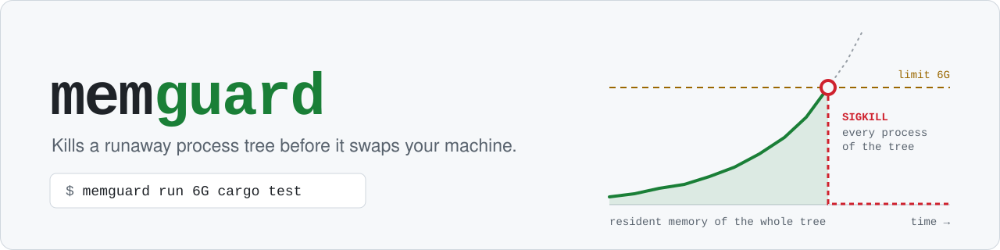

<picture>
  <source media="(prefers-color-scheme: dark)" srcset="docs/img/banner-dark.svg">
  
</picture>

`memguard` keeps a runaway command from swapping your machine to death. It does two things:

- **`memguard run <limit> <command>...`** runs a command and kills its whole process tree (the command, its session
  and every descendant) the moment the tree's combined resident memory passes the limit. It can also kill the tree
  when any single process passes a size of its own, or when the command runs too long. Nothing the command starts
  outlives it: not what it leaves running, not what it orphans, and not even a guard killed with `SIGKILL`.
- **`memguard check <command>`** says whether a shell command must run through `memguard run`, by rules you write in a
  TOML file (for example: every `cargo test` must). It is meant for tools that run commands on your behalf, such as
  coding agents, editors and git hooks.

macOS and Linux.

## Install

```sh
cargo install --locked --git https://github.com/FelixKahle/memguard
```

Or from a checkout, `cargo install --locked --path .`. Either puts the binary at `~/.cargo/bin/memguard`.

## Quick start

Run a test suite with at most 6 GB of resident memory for the whole tree, 2 GB for any one process, and 15 minutes:

```sh
memguard run --per-process 2G --timeout 15m 6G cargo test
```

Past any limit, every process of the tree is killed, `memguard` says which limit was passed, and it exits with 137.
Otherwise it exits with the command's own code and reports the peak:

```text
memguard: peak 1.2 GB
memguard: killed the tree at 6.3 GB (limit 6.0 GB)
```

To make sure tools that run commands for you always go through the guard, install the rules for Rust projects and
ask `memguard check` before running a command:

```sh
mkdir -p ~/.config/memguard && cp examples/rules.toml ~/.config/memguard/rules.toml
memguard check 'cargo test'             # exits 1: must run through memguard run, reason on stderr
memguard check 'memguard run 6G cargo test'   # exits 0
```

[`memguard check`](docs/check.md#integrations) shows how to wire this into a Claude Code hook or a shell function.

## Documentation

| Page | What it covers |
|---|---|
| [`memguard run`](docs/run.md) | options, units, messages, signals, the watchdog, exit codes, and what cannot be contained |
| [`memguard check`](docs/check.md) | the rules file, its patterns, and integrations |
| [How memguard works](docs/design.md) | the session that contains the tree, freeze-then-kill, signals, the watchdog, the code map |
| [Using memguard as a library](docs/library.md) | the Rust API, with examples that run as doctests |
| [Development](docs/development.md) | layout, building, testing under a guard, conventions |

## License

MIT, see [LICENSE](LICENSE).
